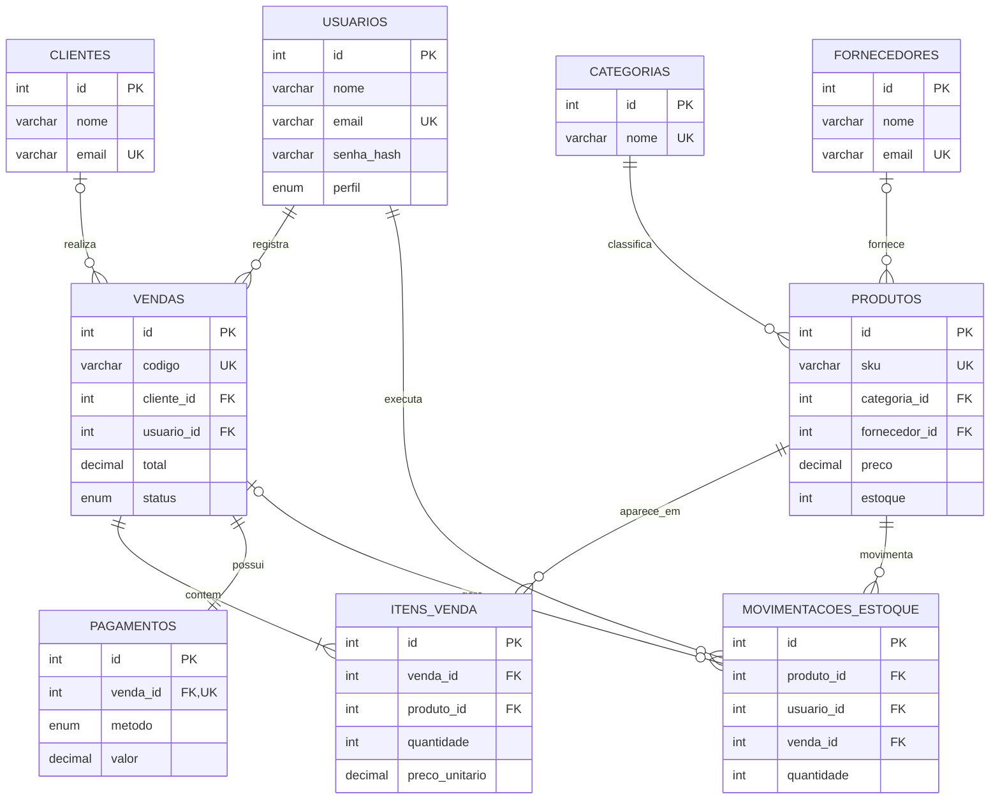

# DER — Diagrama Entidade-Relacionamento

Abra este arquivo no GitHub ou num editor compatível com Mermaid. Existe também a imagem vetorial **DER.svg** para mostrar sem Internet na apresentação.

## Relação muitos-para-muitos

Uma venda pode incluir vários produtos e um produto pode participar de várias vendas. Em bancos relacionais, representamos essa ligação com **`itens_venda`**, uma tabela intermediária que também guarda quantidade, preço unitário no momento da venda e total por item. A combinação `(venda_id, produto_id)` é UNIQUE e impede repetições do mesmo produto na mesma venda.

## Integridade

`produtos.categoria_id` aponta para `categorias.id`; `vendas.usuario_id` aponta para quem atendeu; `itens_venda.venda_id` para a venda e `itens_venda.produto_id` para o produto. Em tabelas históricas não fazemos exclusão física das entidades: `ativo=0` preserva vínculos e dados auditáveis. `pagamentos.venda_id UNIQUE` garante apenas um registro de pagamento por venda nesta versão simplificada.
